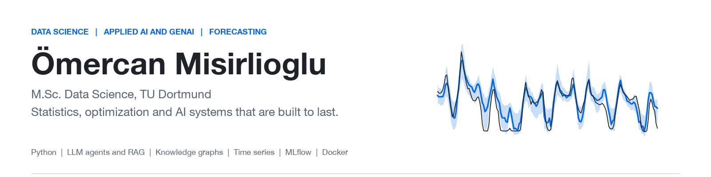
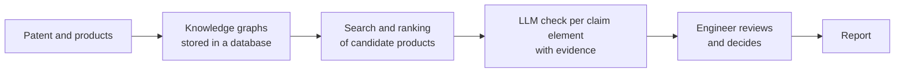

<picture>
  <source media="(prefers-color-scheme: dark)" srcset="assets/banner-dark.png">
  
</picture>

# Hi, I'm Ömercan

I'm a data scientist and I finish my M.Sc. Data Science at TU Dortmund in December 2026. My background is industrial engineering. I build AI systems that are planned before they are built, that can be measured, and that are made to be used for a long time. I work in applied AI and GenAI, forecasting and time series, statistical modelling, optimization and simulation.

## Recent projects

<table>
<tr>
<td width="50%" valign="top">

<b><a href="https://github.com/Omercan4/energiewende-agent">energiewende-agent</a></b> 
<b>Result: 94 % of the answers fully correct (35 test questions, LLM judge).</b> 
An LLM agent (LangGraph) that answers questions about German energy. Python calculates the numbers and the LLM explains them. It uses live data APIs, a price forecast tool and RAG over 99 Bundestag documents, and it names its sources. I tested it with 35 questions and an LLM judge in MLflow. FastAPI, Docker, CI, Azure.
</td>
<td width="50%" valign="top">

<b><a href="https://github.com/Omercan4/energy-price-forecast">energy-price-forecast</a></b> 
<b>Result: 22.3 % lower error than the best classical baseline.</b> 
Day-ahead electricity prices for Germany with LightGBM quantile models and an 80 % prediction interval (79 % measured). I tested it with a 12-month rolling backtest. It includes anomaly detection, and a daily GitHub Action scores finished days and checks drift. <a href="https://omercan4.github.io/energy-price-forecast/">Live page</a>.
</td>
</tr>
<tr>
<td width="50%" valign="top">

<b><a href="https://github.com/Omercan4/credit-risk-scorecard">credit-risk-scorecard</a></b> 
<b>Result: Gini 0.30 on a later year than the training data.</b> 
A loan scorecard built the way a bank builds it, on 2.26 million Lending Club loans. It uses WoE binning, gives reasons for every decision, and is tested on a later year than it was trained on. It also has a profit-based cut-off, a reject-bias analysis and monitoring that caught a 1.49× drift in defaults. <a href="https://omercan4.github.io/credit-risk-scorecard/">Live page</a>.
</td>
<td width="50%" valign="top">
<b>Patent Scout</b> (company tool, code is private, <a href="#patent-scout-an-ai-tool-for-patent-engineers">details below</a>)  
An AI tool for the patent engineers at Böllhoff. It automates a large part of the search for products that may infringe a patent. I built the backend and the web front end myself, and I keep changing it with the engineers' feedback.
</td>
</tr>
</table>

## Projects from my studies

The newer projects stand on these. This is where I learned statistics, simulation and optimization properly. All code is in [My-Projects](https://github.com/Omercan4/My-Projects).

**Statistics and machine learning**
- [Bayesian Analysis of the World Happiness Report](https://github.com/Omercan4/My-Projects/tree/main/Master%20Projects/Bayesian%20Analysis%20of%20World%20Happiness%20Report): Bayesian multilevel models in Stan and R for the drivers of life satisfaction, with uncertainty and effect sizes.
- [Inferring Initial Conditions in the 3-Body Problem](https://github.com/Omercan4/My-Projects/tree/main/Master%20Projects/Inferring_Initial_Conditions_in_the_3_body_Problem): simulation-based inference in Python.
- [Spotify Recommendation Algorithm Analysis](https://github.com/Omercan4/My-Projects/tree/main/Master%20Projects/Spotify%20Recommendation%20Algorithm%20Analysis): a full-factorial design with 90 user profiles, analysed with cosine similarity, ANOVA and t-tests.
- [Forecasting Gasoline Prices](https://github.com/Omercan4/My-Projects/tree/main/Bachelor%20Projects/Forecasting%20Gasoline%20Prices%20using%20Time%20Series%20and%20Regression): ARIMA and regression, compared by RMSE and MAPE (R).
- [Customer Segmentation Analysis](https://github.com/Omercan4/My-Projects/tree/main/Bachelor%20Projects/Customer%20Segmentation%20Analysis%20for%20East-West%20Airlines): segmenting airline customers with machine learning.
- [Predicting Bank Term Deposits and Seoul Bike Rentals](https://github.com/Omercan4/My-Projects/tree/main/Bachelor%20Projects/Predicting%20Bank%20Term%20Deposits%20and%20Seoul%20Bike%20Rentals%20using%20Machine%20Learning%20and%20Data%20Analysis): machine learning and data analysis on two data sets.
- [Classification of e-Mails using R](https://github.com/Omercan4/My-Projects/tree/main/Bachelor%20Projects/Data%20Mining%20-Classification%20of%20e-Mails%20using%20R): a data mining project.

**Simulation, optimization and stochastic models**
- [Graduation Project: Conversational Schedule Explainer](https://github.com/Omercan4/My-Projects/tree/main/Bachelor%20Projects/Graduation%20Project%20-%20Conversational%20Schedule%20Explainer%20using%20ChatGPT%20API): a chat assistant that connects a language model to Python tools and Gurobi shift-scheduling models, so you can ask for swaps, feasibility checks and rescheduling in plain language. **This was ahead of its time.** Today everybody connects tools to chatbots and agents. My team of three built it in 2023/24, right after OpenAI released function calling.
- [Steady State Probability in Ergodic Markov Chains](https://github.com/Omercan4/My-Projects/tree/main/Bachelor%20Projects/Analyzing%20Steady%20State%20Probability%20in%20Ergodic%20Markov%20Chains), [Generating Random Graphs with Prescribed Degree Sequence](https://github.com/Omercan4/My-Projects/tree/main/Bachelor%20Projects/Generating%20Random%20Graphs%20with%20Prescribed%20Degree%20Sequence), [Single-Machine Scheduling](https://github.com/Omercan4/My-Projects/tree/main/Bachelor%20Projects/Exploring%20Optimization%20in%20Single-Machine%20Scheduling), [Service System in Arena](https://github.com/Omercan4/My-Projects/tree/main/Bachelor%20Projects/Modelling%20a%20Service%20System%20Using%20Arena), [Flexible Manufacturing System layout](https://github.com/Omercan4/My-Projects/tree/main/Bachelor%20Projects/Layout%20Design%20for%20a%20Hypotethical%20Flexible%20Manufacturing%20System)
- [All Bachelor projects](https://github.com/Omercan4/My-Projects/tree/main/Bachelor%20Projects) and [all Master projects](https://github.com/Omercan4/My-Projects/tree/main/Master%20Projects)

## Patent Scout: an AI tool for patent engineers

Patent Scout is a working tool at Wilhelm Böllhoff. It automates a big use case in the R&D and patent department, and more use cases are planned. Patent engineers check whether products may infringe a patent. Before, this meant reading claims, searching for products and comparing everything by hand in several tools. Now the engineer enters a patent number and works with the result.

**What I did.**
- I built the whole tool from the ground up: the backend and the web front end, in parallel. I started with the work steps of the engineers and learned the patent field first, because I had no background in it.
- I extract knowledge graphs from patent claims and products, store them in a database that I designed and manage, and run the search on that database.
- I set up the Git structure for the team repository and advise the team on how to use Git, so that several people can work on the code without breaking each other's work.
- I work on the prompts as a part of the product: I write, test and improve them, and I built a prompt editor into the tool. Engineers can open a prompt, change it and save it as a new version. Nothing is overwritten, so versions can be compared and a bad change can be undone.
- I change it with the engineers' feedback. The engineer always has the last word, and a correction is saved next to the model's answer.
- I tested it like software, with automated tests, an offline end-to-end test and documentation, so others can install and maintain it.

**Where I am taking it.** Make it ready for long-term use, lower the cost per analysis, increase the precision and correctness of the answers and reduce the manual work of the engineers even more.

The code is private.

*My master's thesis (TU Dortmund with Wilhelm Böllhoff, submission 1 December 2026) asks the research question behind it: AI-Based Patent Infringement Detection Using Knowledge Graphs and Multimodal Language Models.*

## Working with AI

I made this README together with Claude Code, and I built my recent projects with its help too. I want to say that openly. The AI tools that understand our language and follow our rules and needs are the future of this field, and I want to build my career on them. The tools are useful when the human side is right: a clear question, domain knowledge, checking every result, and taking responsibility for it. With that, I think our creativity and talents can grow a lot. So I show what I did myself and what I did with AI.

## Outside of work

I play basketball and I coach. I was team captain for four years, and with Tofaş I won the Turkish U14 championship in 2013. For years I was a volunteer program lead and coach for international youth camps. Leading a team, advising people and keeping a process efficient are part of how I work. I think they matter in data and AI as well, because good results for a goal, and especially in the long run, need good teamwork and a clear process.

<b>Experience and education</b>

- **Wilhelm Böllhoff, AI & Automation** (Mar 2026 to Dec 2026): Intern and master's thesis student in the R&D and patent department. Built AI-powered pipelines with multimodal models (ChatGPT, Claude, Gemini) and cut analysis time by at least 20 times by parallelizing the workflow and removing key bottlenecks. Connected an external API to parallel LLM queries with spreadsheet output, which reduced hours of manual search to a few minutes of input. Designed a modular Python codebase from scratch, replacing unstructured notebooks with a clean, reusable project structure in the team repository (Git), and implemented RAG and GraphRAG retrieval over knowledge graphs to structure, query and analyze patent-relevant information.
- **Hitit Computer Services, Airline IT Solutions** (Mar 2024 to Sep 2024): Business analyst. Translated airlines' operational requirements into specifications for software modules, ran system tests and contributed to RFPs and proofs of concept by defining KPIs for performance, scalability and robustness.
- **4GLOBAL PLC** (Aug 2022 to Mar 2024): Data analytics intern (remote). Ran industry analyses for 50+ European fitness operators and supported the NEOM project strategy with location intelligence from satellite and map data.
- **Geleceğin Yıldızları (Future Stars)** (May 2019 to Jul 2023): Volunteer program lead and coach. Led multinational youth summer camps with 2000+ participants and 400 staff from 10 countries.
- **M.Sc. Data Science**, TU Dortmund University (Oct 2024 to present), GPA 1.7. Coursework includes advanced statistics, simulation-based inference, neural networks, high-dimensional time series and forecasting, network theory, game theory, generalized linear models, big-data analysis, Bayesian analysis and multilevel models.
- **B.Sc. Industrial Engineering**, Boğaziçi University, Istanbul (2018 to 2024), GPA 1.7 (German scale). Coursework includes statistics, optimization, time series and forecasting, data mining and machine learning, simulation (Siman, ARENA, Python), SQL, and production and supply chain.

<b>Skills</b>

- **Generative AI and LLMs:** multimodal models (ChatGPT, Claude, Gemini), RAG, GraphRAG, prompt engineering and optimization, API integration, knowledge graphs, agents (LangGraph)
- **Programming:** Python (NumPy, pandas, scikit-learn), R, SQL, C/C++; modular codebases, Git workflows for teams, database management
- **Machine learning and statistics:** regression, classification, neural networks, Bayesian inference (Stan), time series and forecasting, gradient boosting (LightGBM), prediction intervals, anomaly detection, credit scorecards (WoE/IV, out-of-time validation, PSI/CSI monitoring), simulation-based inference, process automation
- **Tools and deployment:** FastAPI, MLflow, Docker, GitHub Actions, Azure, Databricks (introductory), simulation (SimPy, ARENA), LaTeX, Microsoft Office

**Languages:** German (C1), English (C1), Turkish (native)

**Find me:** [LinkedIn](https://www.linkedin.com/in/omercanmisirlioglu4) · [GitHub](https://github.com/Omercan4)
